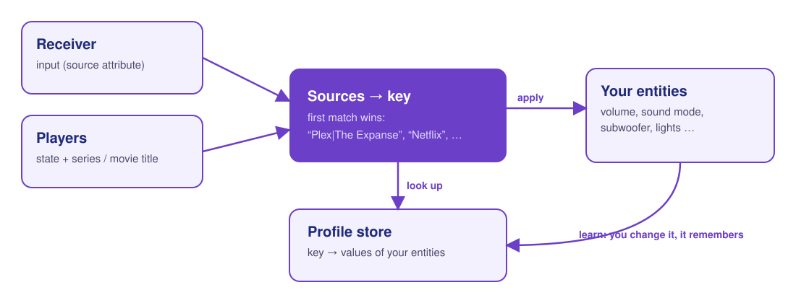

<p align="center"></p>

<p align="center">
  <a href="https://hacs.xyz"></a>
  
  
</p>

[English](README.md) · **Deutsch**

Jede App, jede Serie und jeder Film klingt ein wenig anders. Eine Streaming-App ist leise, ein Film
braucht mehr Lautstärke, der Subwoofer soll bei Action an sein und bei den Nachrichten aus. Der
**Entertainment Profiler** merkt sich solche Einstellungen *pro App und pro Serie / Film* und stellt
sie beim nächsten Mal automatisch wieder ein. Er lernt dabei von dir: Du drehst einfach die
Lautstärke dorthin, wo sie dir gefällt.

Er ist **nicht an eine Marke gebunden**. Er funktioniert mit jedem Receiver, jeder Soundbar, jedem
Subwoofer, Licht oder jeder Steckdose, die Home Assistant steuern kann: Du gibst nur an, welche
Entitäten er sich merken soll.

<p align="center"></p>

## Funktionen

- **Pro App *und* pro Serie / Film.** `Plex|The Expanse` kann anders klingen als `Plex|Dune`; Apps
  ohne Titel (eine Nachrichten-App, eine Spielekonsole) bekommen ein Profil pro App.
- **Merkt sich beliebige Entitäten:** Lautstärke und Klangmodus des Receivers (`media_player`),
  Subwoofer- oder andere Pegel (`number`, `input_number`), Schalter (`switch`, `input_boolean`),
  Auswahlfelder (`select`, `input_select`) und Lichter (`light`, An/Aus und Helligkeit).
- **Lernt automatisch.** Lautstärke ändern, ein paar Sekunden warten, fertig: Das Profil ist
  gespeichert. Kurze automatische Änderungen direkt nach dem Start eines Titels (z. B. wenn der
  Receiver selbst den Klangmodus wechselt) werden *nicht* mitgelernt.
- **Wendet automatisch an**, sobald App oder Titel wechseln. Ein Receiver, der die Lautstärke selbst
  hochfährt oder den Befehl beim Eingangswechsel ignoriert, wird berücksichtigt: Das Ergebnis wird
  geprüft und der Befehl bei Bedarf wiederholt.
- **Sicherheitsgrenzen** für die Lautstärke (z. B. nie unter 30 % oder über 70 %).
- **Feste Profile:** Lernen für eine Quelle ausschalten (z. B. eine Kinder-App) und das Profil von
  Hand pflegen.
- **Eine Serie, ein Profil:** Optional ohne App-Namen im Schlüssel, dann teilen sich *Die Simpsons*
  auf Plex und Disney+ dasselbe Profil.
- **Mehrere Apps auf einem Player:** Ein App-Filter (`app_name`) trennt z. B. Netflix, Disney+ und
  Plex auf demselben Apple TV.
- **Ersatz-, Standard- und Leerlauf-Profil:** Ohne eigenes Profil gilt das Profil der Quelle (z. B.
  `Disney+`), sonst ein Profil namens `Standard`;
  ein optionales *Leerlauf*-Profil gilt, wenn der Receiver an ist, aber nichts läuft.
- **Profile in der Oberfläche bearbeiten:** Alle Profile sind eine To-do-Liste (Titel = Schlüssel,
  Beschreibung = Werte).
- **Mehrere Profiler** (Wohnzimmer, Schlafzimmer, …) nebeneinander.
- Optionale Meldungen, wenn ein Profil angewendet oder gelernt wird.

## Installation

### HACS (empfohlen)

1. HACS → ⋮ → **Benutzerdefinierte Repositories** → `https://github.com/dr-apple/ha-entertainment-profiler`
   als Kategorie **Integration** hinzufügen.
2. **Entertainment Profiler** installieren und Home Assistant neu starten.
3. **Einstellungen → Geräte & Dienste → Integration hinzufügen → Entertainment Profiler.**

### Manuell

Den Ordner `custom_components/entertainment_profiler` nach `config/custom_components` kopieren und
Home Assistant neu starten.

## Einrichtung

### 1. Profiler anlegen

| Feld | Bedeutung |
|---|---|
| **Name** | Zum Beispiel *Wohnzimmer*. Wird für Gerät und Entitätsnamen verwendet. |
| **Receiver** *(optional)* | Ein `media_player`, dessen Attribut `source` den aktiven Eingang nennt. Nur nötig, wenn der Receiver-Eingang entscheidet, was du gerade schaust. |
| **Entitäten, die ein Profil steuert** | Alles, was ein Profil sich merken und wiederherstellen soll. Wähle zum Beispiel den Receiver (Lautstärke + Klangmodus), einen Subwoofer-Pegel (`number`) und einen Subwoofer-Schalter. |

### 2. Quellen hinzufügen

Integration öffnen → **Konfigurieren → Quellen → Quelle hinzufügen**. Eine *Quelle* sagt, wann eine
App oder ein Eingang aktiv ist und woher der Titel kommt.

| Feld | Bedeutung |
|---|---|
| **Name** | Der Profilname der App, z. B. `Plex`, `Netflix`, `SmartTube`. Darf kein `\|` enthalten. |
| **Media Player** | Der Player, der den Titel liefert (z. B. dein Apple TV / Plex / Android TV Player). |
| **Nur bei diesen Apps** | Optional. Vergleicht das Attribut `app_name` des Players. Nötig, wenn ein Player mehrere Apps abspielt (Apple TV, Android TV). |
| **Nur aktiv, wenn der Receiver-Eingang** | Optional. Zum Beispiel `TV Audio` für den Google-TV-Eingang. Leer lassen, um nur den Zustand des Players zu nutzen. |
| **Titel für Serien / Filme** | *Automatisch* (Serienname, sonst Titel), *Serienname*, *Medientitel*, *Eigenes Attribut* oder *keiner* (ein Profil pro Quelle). Beim eigenen Attribut wird der Medientitel genommen, wenn der Wert leer oder nur eine Jahreszahl ist (bei Filmen üblich). |
| **Nur aktiv, solange der Player spielt** | Aus, wenn allein der Receiver-Eingang entscheidet (der Player darf im Leerlauf sein). |
| **Profile lernen** | Aus bei Quellen mit festem Profil. |

Die **erste passende Quelle gilt**, lege also die genaueste zuerst an.

### 3. Einstellungen

**Konfigurieren → Einstellungen** enthält die Lautstärkegrenzen, die Zeiten und die Meldungen. Die
Vorgaben sind ein guter Start:

| Einstellung | Vorgabe | Bedeutung |
|---|---|---|
| Niedrigste / höchste Lautstärke | 0 / 100 % | Sicherheitsgrenzen beim Anwenden eines Profils. |
| Wartezeit, bevor ein Wechsel gilt | 1 s | Entprellt flackernde Player. |
| Verzögerung vor dem Anwenden | 0 s | Sofort anwenden. |
| Lernen, wenn die Werte unverändert waren für | 30 s | Wie lange du eine Einstellung in Ruhe lassen musst, bevor sie gespeichert wird. |
| Nur lernen, wenn derselbe Titel schon lief seit | 40 s | Hält die Änderungen des Receivers beim Titelstart aus deinen Profilen heraus. |
| Warten, bis der Receiver die Lautstärke erreicht | 20 s | Danach wird der Befehl wiederholt. |
| Name des Leerlauf-Profils | *(aus)* | Zum Beispiel `Leerlauf`. |
| App-Namen in den Schlüssel aufnehmen | an | Aus: Schlüssel ist nur der Titel (`Die Simpsons` statt `Disney+\|Die Simpsons`). Ohne Titel bleibt der App-Name. |

## Beispiel: Receiver + Subwoofer + drei Quellen

Ein Wohnzimmer mit AV-Receiver, einem Subwoofer mit Pegel (`number`) und Schalter und drei
Möglichkeiten zum Schauen:

*Entitäten:* `media_player.wohnzimmer_receiver`, `number.subwoofer_pegel`, `switch.subwoofer`

| Quelle | Player | Receiver-Eingang | Titel | Lernen |
|---|---|---|---|---|
| `SmartTube` | `media_player.google_tv` | `TV Audio` | keiner | aus (fest) |
| `Plex` | `media_player.apple_tv_plex` | *(leer)* | automatisch | an |
| `Disney+` | `media_player.android_tv` | *(leer)* | Medientitel | an |

Das feste Profil einmal anlegen:

```yaml
action: entertainment_profiler.save_profile
data:
  key: SmartTube
  values:
    media_player.wohnzimmer_receiver: { volume: 40, sound_mode: Stereo }
    number.subwoofer_pegel: -6
    switch.subwoofer: true
```

Ab jetzt gilt: Starte eine Plex-Folge, drehe den Receiver auf deine Lieblingslautstärke, warte 30
Sekunden — das Profil `Plex|<Serie>` existiert. Beim nächsten Start dieser Serie stimmt die
Lautstärke von Anfang an.

## Entitäten

Pro Profiler:

| Entität | Was sie tut |
|---|---|
| `sensor.<name>_aktives_profil` | Der aktuelle Schlüssel, z. B. `Plex\|The Expanse`. Die Attribute zeigen Quelle, Titel, die Profilwerte und ob das Standardprofil gilt. |
| `sensor.<name>_gespeicherte_profile` | Anzahl der gespeicherten Profile; die Schlüssel stehen in den Attributen. |
| `switch.<name>_automatisch_anwenden` | Automatisches Anwenden ein- oder ausschalten. |
| `switch.<name>_automatisch_lernen` | Automatisches Lernen ein- oder ausschalten. |
| `button.<name>_profil_jetzt_anwenden` | Das Profil dessen anwenden, was gerade läuft. |
| `button.<name>_aktuelle_werte_speichern` | Die aktuellen Werte als Profil dessen speichern, was gerade läuft. |
| `todo.<name>_profile` | Alle Profile als To-do-Liste: Titel = Schlüssel, Beschreibung = Werte als JSON. Hier kannst du sie anlegen, ändern und löschen. |

## Dienste

| Dienst | Zweck |
|---|---|
| `entertainment_profiler.save_profile` | Ein Profil speichern. Ohne `values` werden die aktuellen Werte gespeichert. Ohne `key` gilt der aktive Schlüssel. |
| `entertainment_profiler.apply_profile` | Das Profil eines Schlüssels anwenden (Standard: der aktive). |
| `entertainment_profiler.delete_profile` | Ein Profil löschen. |
| `entertainment_profiler.list_profiles` | Alle Profile zurückgeben (Dienstantwort). |
| `entertainment_profiler.import_profiles` | Viele Profile auf einmal speichern, optional alle vorhandenen ersetzen. |

Bei mehreren Profilern `entry_id` (oder den Profiler-Namen) angeben.

### Profilformat

Ein Profil ordnet Entitäts-IDs Werte zu:

| Entitätstyp | Wert |
|---|---|
| `media_player` | `{ "volume": 0-100, "sound_mode": "Movie" }` |
| `number`, `input_number` | `-6.0` |
| `switch`, `input_boolean` | `true` / `false` |
| `select`, `input_select` | `"Name der Option"` |
| `light` | `{ "on": true, "brightness": 0-100 }` |

## Tipps

- **Die Lautstärkeskala ist die deiner Entität.** Bei einem `media_player` ist die Lautstärke
  `volume_level × 100`, also die Zahl, die die meisten Receiver im Display zeigen.
- **Der Receiver erreicht die Lautstärke nicht?** *Warten, bis der Receiver die Lautstärke erreicht*
  erhöhen.
- **Ein Profil wird ständig von der Receiver-Automatik überschrieben.** *Nur lernen, wenn derselbe
  Titel schon lief seit* erhöhen.
- **Beim Start passiert nichts.** Das ist Absicht: Nach einem Neustart merkt sich der Profiler nur,
  was läuft; Profile werden angewendet, wenn sich *etwas ändert*.

## Entwicklung

```bash
python -m venv .venv && . .venv/bin/activate
pip install -r requirements_test.txt
pytest
```

## Lizenz

MIT — siehe [LICENSE](LICENSE).
