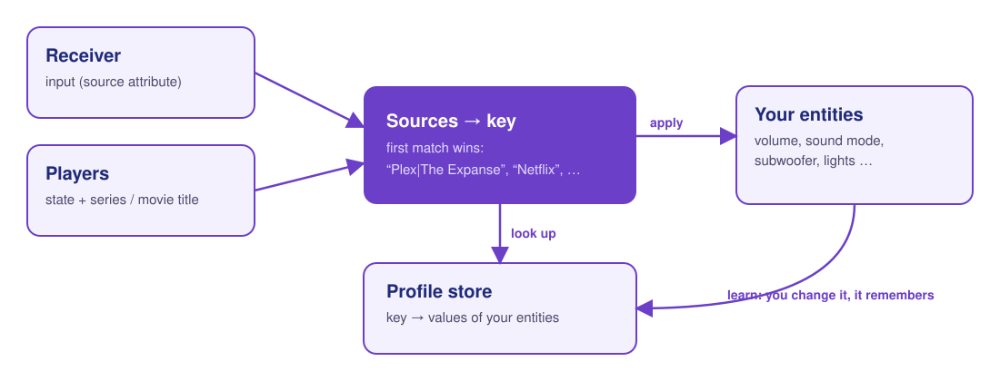
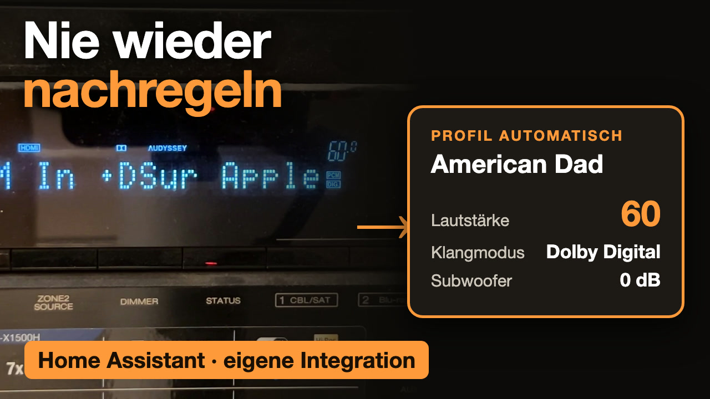

<p align="center"></p>

<p align="center">
  <a href="https://hacs.xyz"></a>
  
  
</p>

**English** · [Deutsch](README.de.md)

Every app, series and movie sounds a bit different. A streaming app is quiet, a film needs more
volume, the subwoofer should be on for action and off for the news. **Entertainment Profiler**
remembers those settings *per app and per series / movie* and puts them back automatically the next
time. It learns from what you do — you just turn the volume to where you like it.

It is **not tied to any brand**. It works with any receiver, soundbar, subwoofer, light or smart plug
Home Assistant can control: you simply tell it which entities to remember.

<p align="center"></p>

## Video

<p align="center">
  <a href="https://youtu.be/MSWej_OsfR0"></a><br>
  <a href="https://youtu.be/MSWej_OsfR0"></a>
  <a href="https://youtube.com/shorts/tSUVFV7G47I"></a>
</p>

Setup and the integration in action with a real receiver (in German, 5 min).

## Features

- **Per app *and* per series / movie.** `Plex|The Expanse` can sound different from `Plex|Dune`; apps
  without a title (a news app, a game console) get one profile per app.
- **Remembers any of your entities:** receiver volume and sound mode (`media_player`), subwoofer or
  other levels (`number`, `input_number`), switches (`switch`, `input_boolean`), selects
  (`select`, `input_select`) and lights (`light`, on/off and brightness).
- **Learns automatically.** Change the volume, wait a few seconds, done — the profile is stored.
  Short automatic changes right after a title starts (e.g. the receiver switching sound mode) are
  *not* learned.
- **Applies automatically** as soon as the active app or title changes. A receiver that ramps the
  volume itself or ignores the command while switching inputs is handled: the result is verified and
  the command is repeated if needed.
- **Safety limits** for the volume (for example never below 30 % or above 70 %).
- **Fixed profiles:** switch learning off for a source (for example a kids' app) and edit its profile
  by hand.
- **One series, one profile:** optionally without the app name in the key, so *The Simpsons* on Plex
  and Disney+ share one profile.
- **Several apps on one player:** an app filter (`app_name`) separates e.g. Netflix, Disney+ and Plex
  on the same Apple TV.
- **Fallback, default and idle profile:** without its own profile the source's profile is used (e.g.
  `Disney+`), otherwise a profile called `Standard` is used for anything without its own
  profile; an optional *idle* profile applies when the receiver is on but nothing plays.
- **Edit profiles in the UI:** all profiles are a to-do list (title = key, description = values).
- **Several profilers** (living room, bedroom, …) side by side.
- Optional notifications when a profile is applied or learned.

## Installation

### HACS (recommended)

1. HACS → ⋮ → **Custom repositories** → add `https://github.com/dr-apple/ha-entertainment-profiler`
   as category **Integration**.
2. Install **Entertainment Profiler** and restart Home Assistant.
3. **Settings → Devices & services → Add integration → Entertainment Profiler.**

### Manual

Copy `custom_components/entertainment_profiler` into your `config/custom_components` folder and
restart Home Assistant.

## Setup

### 1. Create the profiler

| Field | Meaning |
|---|---|
| **Name** | For example *Living room*. Used for the device and the entity names. |
| **Receiver** *(optional)* | A `media_player` whose `source` attribute tells which input is active. Only needed if the receiver input decides what you are watching. |
| **Entities a profile controls** | Everything a profile should remember and restore. Pick, for example, the receiver (volume + sound mode), a subwoofer level (`number`) and a subwoofer switch. |

### 2. Add sources

Open the integration → **Configure → Sources → Add source**. A *source* says when an app or input is
active and where the title comes from.

| Field | Meaning |
|---|---|
| **Name** | The profile name of the app, for example `Plex`, `Netflix`, `SmartTube`. Must not contain `\|`. |
| **Media player** | The player that shows the title (for example your Apple TV / Plex / Android TV player). |
| **Only for these apps** | Optional. Compared with the player's `app_name` attribute. Needed when one player plays several apps (Apple TV, Android TV). |
| **Active only if the receiver input is** | Optional. For example `TV Audio` for the Google TV input. Leave empty to rely on the player state only. |
| **Title for series / movies** | *Automatic* (series name, otherwise title), *Series name*, *Media title*, *Own attribute*, or *none* (one profile per source). With an own attribute the media title is used when the value is empty or just a year (common for movies). |
| **Active only while the player is playing** | Off if the receiver input alone decides (the player may be idle). |
| **Learn profiles** | Off for sources with a fixed profile. |

The **first matching source wins**, so add the most specific one first.

### 3. Settings

**Configure → Settings** has the volume limits, the timing and the notifications. The defaults are a
good start:

| Setting | Default | Meaning |
|---|---|---|
| Lowest / highest allowed volume | 0 / 100 % | Safety limits when a profile is applied. |
| Wait before a change is accepted | 1 s | Debounces flickering players. |
| Delay before applying | 0 s | Apply immediately. |
| Learn after values were unchanged for | 30 s | How long you must leave a setting alone before it is stored. |
| Learn only after the same title played for | 40 s | Keeps the receiver's own start-of-title changes out of your profiles. |
| Wait for the receiver to reach the volume | 20 s | Then the command is repeated. |
| Idle profile name | *(off)* | For example `Idle`. |
| Include the app name in the key | on | Off: the key is only the title (`The Simpsons` instead of `Disney+\|The Simpsons`). Without a title the app name stays. |

## Example: receiver + subwoofer + three sources

A living-room setup with an AV receiver, a subwoofer that has a level (`number`) and a switch, and
three ways to watch:

*Entities:* `media_player.living_room_receiver`, `number.subwoofer_level`, `switch.subwoofer`

| Source | Player | Receiver input | Title | Learn |
|---|---|---|---|---|
| `SmartTube` | `media_player.google_tv` | `TV Audio` | none | off (fixed) |
| `Plex` | `media_player.apple_tv_plex` | *(empty)* | automatic | on |
| `Disney+` | `media_player.android_tv` | *(empty)* | media title | on |

Create the fixed profile once:

```yaml
action: entertainment_profiler.save_profile
data:
  key: SmartTube
  values:
    media_player.living_room_receiver: { volume: 40, sound_mode: Stereo }
    number.subwoofer_level: -6
    switch.subwoofer: true
```

From now on: start a Plex episode, turn the receiver to your favourite volume, wait 30 seconds — the
profile `Plex|<series>` exists. Next time that series starts at that volume.

## Entities

For every profiler:

| Entity | What it does |
|---|---|
| `sensor.<name>_active_profile` | The current key, e.g. `Plex\|The Expanse`. Attributes show the source, the title, the profile values and whether the default profile is used, plus the playing player (`media_player`), its `media_content_type` and `media_kind` (`series` / `movie`, otherwise empty), so other integrations can tell whether a series or a movie is playing. If the player only reports `video` (e.g. Apple TV apps), the kind is derived from the series name, an episode code, a bare year or the duration (70 min or more = movie). |
| `sensor.<name>_stored_profiles` | Number of stored profiles; the keys are in the attributes. |
| `switch.<name>_apply_automatically` | Turn automatic applying on or off. |
| `switch.<name>_learn_automatically` | Turn automatic learning on or off. |
| `button.<name>_apply_profile_now` | Apply the profile of what is playing now. |
| `button.<name>_save_current_values` | Store the current values as the profile of what is playing now. |
| `todo.<name>_profiles` | All profiles as a to-do list: title = key, description = values as JSON. Add, edit and delete them here. |

## Services

| Service | Purpose |
|---|---|
| `entertainment_profiler.save_profile` | Store a profile. Without `values` the current values are saved. Without `key` the active key is used. |
| `entertainment_profiler.apply_profile` | Apply the profile of a key (default: the active one). |
| `entertainment_profiler.delete_profile` | Delete a profile. |
| `entertainment_profiler.list_profiles` | Return all profiles (service response). |
| `entertainment_profiler.import_profiles` | Store many profiles at once, optionally replacing all existing ones. |

With several profilers pass `entry_id` (or the profiler name).

### Profile format

A profile maps entity IDs to values:

| Entity type | Value |
|---|---|
| `media_player` | `{ "volume": 0-100, "sound_mode": "Movie" }` |
| `number`, `input_number` | `-6.0` |
| `switch`, `input_boolean` | `true` / `false` |
| `select`, `input_select` | `"Option name"` |
| `light` | `{ "on": true, "brightness": 0-100 }` |

## Tips

- **The volume scale is the one of your entity.** For a `media_player` the volume is
  `volume_level × 100`, which is the number on most receivers' displays.
- **The receiver does not ramp or follow?** Raise *Wait for the receiver to reach the volume*.
- **A profile keeps getting overwritten by the receiver's auto mode.** Raise *Learn only after the
  same title played for*.
- **Nothing happens at start-up.** By design: after a restart the profiler only notes what is playing;
  it applies profiles when something *changes*.

## Development

```bash
python -m venv .venv && . .venv/bin/activate
pip install -r requirements_test.txt
pytest
```

## License

MIT — see [LICENSE](LICENSE).
